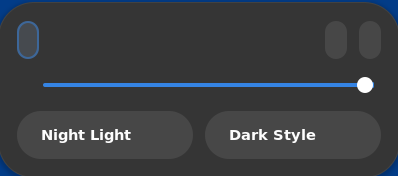
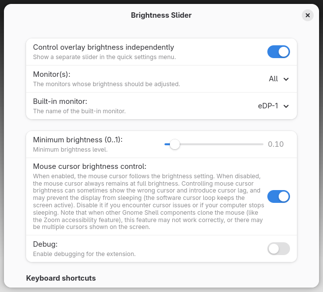

# Brightness Slider



## Overview

Brightness Slider controls display brightness with a software dimming
layer, so internal and external monitors can be dimmed independently of
the hardware backlight. It supports GNOME Shell 45 through 51.

Brightness Slider is a fork of
[Soft Brightness Plus](https://github.com/jkitching/soft-brightness-plus)
by Joel Kitching, which is itself a fork of the original
[Soft brightness](https://github.com/F-i-f/soft-brightness) extension by
Philippe Troin. See [Credits](#credits).

Common uses are:

- Your laptop has no backlight, maybe because it is not supported, or
  you have an OLED display.

- You want to control the brightness level of an external monitor like
  you do with your built-in screen.

Bonus features:

- Minimum brightness level: do not get lost in the dark.

- Optional mouse cursor dimming.

- Keyboard shortcuts for brightness control.

- Disables itself temporarily when a screenshot is taken.

Note that the extension keeps running on the lock screen, as the
brightness setting should apply there as well.

## Configuration

Brightness Slider comes with a configuration panel, accessible from the
Extensions application or from the
[GNOME Shell Extensions page](https://extensions.gnome.org/local/).



### Configuration Settings

#### _Control overlay brightness independently_

When enabled, a separate **Overlay Brightness** slider is shown in the
quick settings menu, and the hardware backlight is not changed by the
extension.

When disabled, Brightness Slider works together with the hardware
backlight. The brightness slider and keyboard brightness hotkeys control
both the backlight and the software dimming layer. This is most useful:

- if you have a backlight and _Monitor(s)_ is set to _External_, or

- if a backlight is detected by GNOME but is not working (like some
  OLED panel laptops which report a backlight brightness which does not
  exist). In that latter case _Monitor(s)_ should be set to _All_.

#### _Monitor(s)_

- If set to _All_, the dimming layer is applied to all attached
  monitors.

- If set to _Built-in_, only the built-in monitor is dimmed. The
  built-in monitor is selected in the setting below _Monitor(s)_.

- If set to _External_, all monitors which are not the built-in monitor
  are dimmed.

#### _Built-in monitor_

A list of currently attached monitors is displayed. Pick from the list
which monitor should be considered the built-in monitor.

The setting only has an effect if _Monitor(s)_ is set to _Built-in_ or
_External_.

#### _Minimum brightness_

Sets the minimum allowable brightness for the display, where _0_ is
completely dark and _1_ is completely bright. Defaults to _0.1_ (10%).

The minimum brightness is also enforced for the panel backlight when the
extension is controlling the hardware backlight.

#### _Mouse cursor brightness control_

Toggles between having the mouse cursor brightness follow the screen
brightness (on) and keeping the mouse cursor at full brightness (off).

GNOME Shell's cursor tracking can occasionally show the wrong cursor
type or size when the mouse cursor brightness follows the screen
brightness. It can also introduce pointer motion lag and may prevent the
display from sleeping, because the software cursor loop keeps the screen
active. Disable it if you encounter cursor issues or if your computer
stops sleeping.

#### _Keyboard shortcuts_

The default shortcuts use Shift plus the hardware brightness keys and
adjust the overlay brightness in 5% steps. Clear a shortcut to disable
it, or set a custom binding with `gsettings`.

#### _Debug_

When enabled, Brightness Slider logs extra debugging information to the
system journal. Use this when reporting a bug.

Debug messages can be watched with:

```shell
journalctl -f | grep 'gnome-shell.*brightness-slider'
```

### Effect on power consumption

Brightness Slider causes extra load on the hardware and therefore
slightly increases power usage, as it needs to composite an extra
dimming layer and track the mouse.

If Brightness Slider dims an LCD panel, changing the software brightness
does not change the panel's power consumption. Use the backlight
instead: lowering the backlight brightness lowers power usage.

If Brightness Slider dims an OLED panel, lowering the software
brightness does lower power usage.

### Common use cases

#### Desktop computer

To control the brightness of all attached monitors:

- Set _Control overlay brightness independently_ to _On_.

- Set _Monitor(s)_ to _All_.

#### Laptop with a backlight

To use the hardware backlight for the built-in display and Brightness
Slider for external displays:

- Set _Control overlay brightness independently_ to _Off_.

- Set _Monitor(s)_ to _External_.

- Configure _Built-in monitor_ to your built-in panel's name.

#### Laptop without a backlight

For example an OLED panel or a non-functional backlight. To have
Brightness Slider control all monitors:

- Set _Control overlay brightness independently_ to _Off_.

- Set _Monitor(s)_ to _All_.

## Installation

Brightness Slider has its own extension UUID
(`brightness-slider@shantanub08.github.io`) and settings schema. It can
be installed alongside Soft Brightness Plus, but the two extensions
should not be enabled at the same time.

### GNOME Extensions

Search for **Brightness Slider** on
[extensions.gnome.org](https://extensions.gnome.org/).

### GitHub releases

Download the latest zip from the
[releases page](https://github.com/shantanub08/brightness-slider/releases),
then run:

```shell
gnome-extensions install --force brightness-slider@shantanub08.github.io.v1.shell-extension.zip
```

Log out and back in after installing, then enable the extension from the
Extensions application.

### From source

Requirements:

- `make`
- `glib-compile-schemas` (glib2)
- `msgfmt` (gettext)
- `zip`
- Node.js 20.6 or later for the unit tests
- `gjs` for the optional schema test

Build the extension zip:

```shell
make zip
```

Install it directly into your user extension directory:

```shell
make install
```

Run the unit tests and schema validation:

```shell
make test
```

After changing the extension code, log out and back in (Wayland) or
restart GNOME Shell (X11) before testing.

## Debugging

Follow GNOME Shell's log:

```shell
journalctl -b 0 -f -o cat /usr/bin/gnome-shell
```

Enable _Debug_ in the preferences, or set it directly:

```shell
gsettings --schemadir ~/.local/share/gnome-shell/extensions/brightness-slider@shantanub08.github.io/schemas \
    set org.gnome.shell.extensions.brightness-slider debug true
```

Check the extension state:

```shell
gnome-extensions info brightness-slider@shantanub08.github.io
```

## Contributing

Please report issues and feature requests on the
[fork's issue tracker](https://github.com/shantanub08/brightness-slider/issues).

## License

Brightness Slider is free software: you can redistribute it and/or
modify it under the terms of the GNU General Public License as published
by the Free Software Foundation, either version 3 of the License, or (at
your option) any later version.

This program is distributed in the hope that it will be useful, but
WITHOUT ANY WARRANTY; without even the implied warranty of
MERCHANTABILITY or FITNESS FOR A PARTICULAR PURPOSE. See the GNU General
Public License for more details.

You should have received a copy of the GNU General Public License along
with this program. If not, see <https://www.gnu.org/licenses/>.

## Credits

- Philippe Troin ([F-i-f](https://github.com/F-i-f)): original
  Soft brightness extension.
- Joel Kitching ([jkitching](https://github.com/jkitching)): Soft
  Brightness Plus.
- Clément Gayot ([Striffly](https://github.com/Striffly)): GNOME Shell 51
  port and shader-target fixes.
- The translators who contributed the Czech, Persian, French, Dutch and
  Turkish translations.

## Changelog

See [CHANGELOG.md](CHANGELOG.md). Release notes for the upstream Soft
Brightness Plus project are available in the
[upstream repository](https://github.com/jkitching/soft-brightness-plus).
